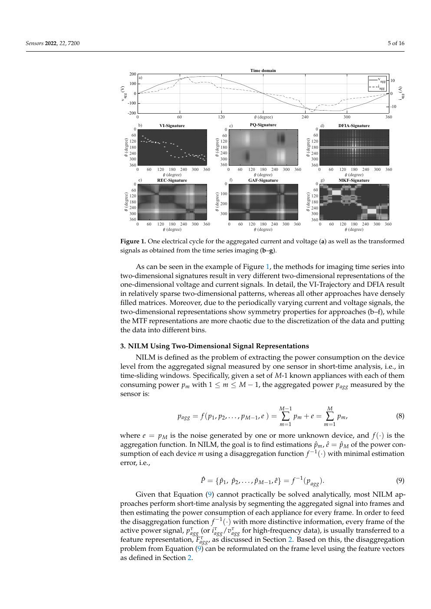
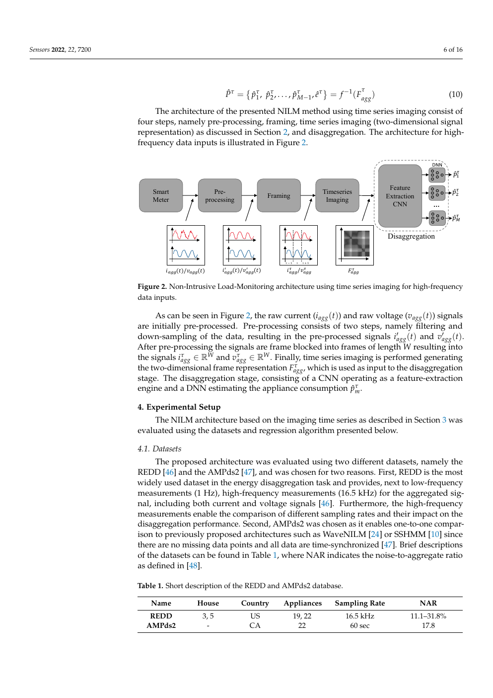
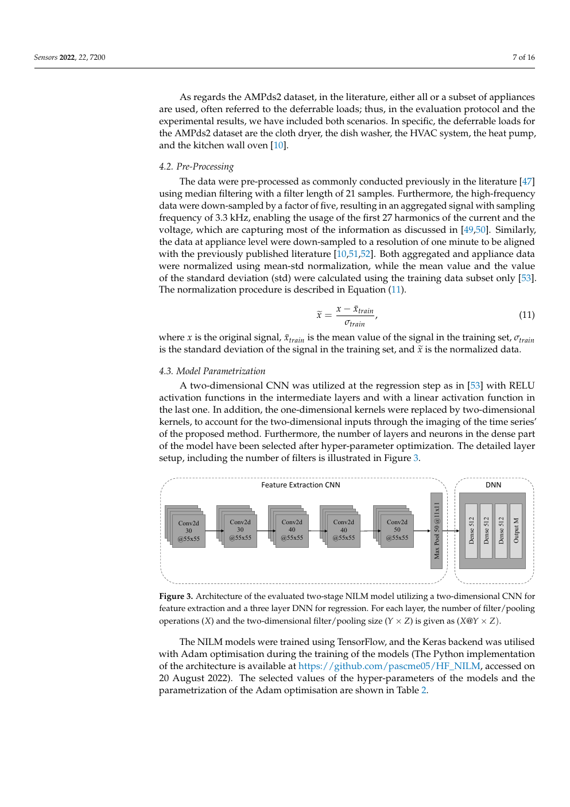

# 2D Transformations of Energy Signals for Energy Disaggregation

## Simple slide-style explanation

**Paper:** Schirmer and Mporas, *Sensors* 2022.  
**Main question:** How do they choose the data, make the input image, and predict appliance power?

---

## 1. The simple idea

They take a **short measurement of the whole house**, turn it into a small 2D image, and give that image to a CNN.

```text
Whole-house electrical signal
        ↓
Short window
        ↓
2D image
        ↓
CNN + Dense network
        ↓
Power prediction for all target appliances
```

The paper compares six ways to make the 2D image. It finds that the **PQ image** is usually best.

---

## 2. What data do they use?

They use two datasets.

| Dataset | Input signals | Main experiment |
|---|---|---|
| REDD Houses 3 and 5 | High-frequency whole-house current \(I\) and voltage \(V\) | High-frequency experiment |
| AMPds2 | Low-frequency whole-house active power \(P\) and reactive power \(Q\) | Low-frequency comparison |

For REDD, the model does **not** see separate appliance waveforms. It sees only the whole-house aggregate \(I,V\) signal. The appliance power readings are the training labels.

---

## 3. REDD: how one input sample is selected

The original REDD high-frequency recording is a long, continuous aggregate \(I,V\) waveform.

The paper processes it as follows:

```text
Continuous REDD aggregate I/V
        ↓
Median filtering and downsampling
16.5 kHz → 3.3 kHz
        ↓
Take a short frame of 55 I samples and 55 V samples
        ↓
Make one 55 × 55 image
        ↓
Pair it with an appliance-power target vector
```

The 55-point window at 3.3 kHz lasts about:

\[
55/3300 \approx 16.7\text{ ms}
\]

This is roughly one 60 Hz mains cycle.

---

## 4. Important: it is NOT a 6-second block

The earlier COLD paper used a 6-second high-frequency waveform. **This paper does not.**

```text
COLD:       6-second waveform → STFT image

This paper:  55 I/V samples → 55 × 55 image
             about 16.7 ms of waveform
```

The paper does not clearly explain how it chooses the exact 16.7 ms waveform associated with each slow appliance-power label. This is its main reproducibility weakness.

---

## 5. What is the image?

For the most successful feature, PQ, the input image is made from current and voltage:

\[
F_{ij}=I(i)\times V(j)
\]

So the input is:

```text
55 current values
      ×
55 voltage values
      ↓
one 55 × 55 matrix/image
```

The diagonal is ordinary instantaneous power:

\[
F_{ii}=I(i)V(i)
\]

The rest of the image contains cross-time current-voltage relationships.

---

## 6. Figure 1 in the paper: six possible images

The top plot is one cycle of aggregate voltage and current. The six plots below are six different ways of turning that signal into a 2D image.

- **VI:** voltage-current trajectory
- **PQ:** current-voltage power-like matrix
- **DFIA:** two-dimensional Fourier representation
- **REC, GAF, MKF:** one-signal time-series images



The paper tries one image type at a time. It does **not** put all six images into the model together.

---

## 7. Which image is best?

The authors' main finding is:

```text
Use two signals together
(I + V, or P + Q)
      ↓
Usually better than using one signal only
```

PQ is the best overall choice in their tests because it is accurate and fast.

| Result | Best feature |
|---|---|
| REDD House 3 | PQ: 86.26% accuracy |
| AMPds2, all 22 loads | PQ: 89.94% accuracy |
| AMPds2, five deferrable loads | PQ: 94.78% accuracy |

For very noisy signals, VI trajectories are more robust than PQ.

---

## 8. Figure 2 in the paper: the full pipeline

Read Figure 2 from left to right:

```text
Smart meter
  → preprocessing
  → framing
  → time-series image
  → CNN + DNN
  → predicted appliance powers
```



---

## 9. What exactly enters the model?

For the high-frequency REDD experiment, **one input sample** is:

```text
Input image: 55 × 55 × 1
               ↑    ↑
               I    V
```

It is a single-channel 2D image created from one short aggregate current-voltage frame.

For the low-frequency AMPds2 experiment, the same idea uses 30 active-power values and 30 reactive-power values:

```text
Input image: 30 × 30 × 1
               ↑    ↑
               P    Q
```

---

## 10. Figure 3 in the paper: the neural network

The image goes through:

```text
2D image
  → 5 convolution layers
  → max pooling
  → 3 Dense layers
  → Output M
```



`Output M` means there is one output value for each target appliance.

---

## 11. What is the output?

The output is a vector of **predicted power values in watts**:

\[
[\hat p_1,\hat p_2,\ldots,\hat p_M]
\]

For REDD House 3:

```text
Output = 19 appliance-power predictions
```

For REDD House 5:

```text
Output = 22 appliance-power predictions
```

For AMPds2:

```text
Output = 22 appliance-power predictions
or 5 predictions in the deferrable-load experiment
```

---

## 12. Does it predict all appliances at the same time?

**Yes.**

The paper's `Output M` layer and the public code indicate one joint multi-output model:

```text
one aggregate image
        ↓
one CNN
        ↓
[fridge watts,
 kettle watts,
 washing-machine watts,
 ...]
```

It is not one separate CNN per appliance in the main multi-output setup.

It is also **not Softmax** and not a probability output. Several appliances can have positive predicted power at the same time.

---

## 13. Does it select only ON periods or events?

The paper does **not** describe COLD-style selection:

```text
No stated event detector
No stated removal of transition periods
No stated removal of all-off periods
No stated steady-state-only sampling
```

It describes continuous data being framed into inputs. Therefore off periods and normal background periods may be included.

However, the raw-REDD-to-paired-sample script is not published, so we cannot prove exactly which periods ended up in the final training files.

---

## 14. Why is the paper hard to reproduce?

The input image is clear. The missing part is the label matching.

```text
One high-frequency input: about 16.7 ms
One appliance label: much slower; paper says 1-minute resolution
```

The paper does not tell us clearly:

1. Which high-frequency frame is selected for a given label time.
2. Whether one label is reused for many frames.
3. Whether frames near appliance switching are removed.
4. How exact time alignment is checked.

The released code loads already-paired `HF.mat` and `LF.mat` files, but does not provide the full script that creates those files from raw REDD.

---

## 15. Is making images from HF data computationally heavy?

Yes, if you make an image for every possible high-frequency window.

One PQ image contains:

\[
55\times55=3025
\]

values.

At 3.3 kHz, even non-overlapping 55-point windows create about 60 images per second. A long household recording would therefore create many millions of mostly similar images.

```text
Large continuous HF stream
      ↓
many redundant 55 × 55 images
      ↓
large storage + preprocessing + CNN cost
```

This is why a good NILM protocol should select label-anchored windows before creating images.

---

## 16. Bottom line

```text
Input:
short aggregate I/V frame
→ one 55 × 55 PQ / VI / DFIA / other image

Model:
2D CNN + Dense neural network

Output:
all target appliance powers at the same time
→ not probabilities, not Softmax
```

The PQ image is the main useful contribution. The high-frequency label-alignment and sample-selection process is the main weakness.

---

## Sources

- Schirmer, P. A.; Mporas, I. *2D Transformations of Energy Signals for Energy Disaggregation*. Sensors 2022, 22, 7200. https://doi.org/10.3390/s22197200
- Public implementation: https://github.com/pascme05/HF_NILM
