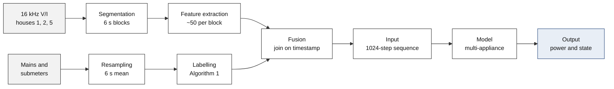

# High-Frequency Data Preparation: NILMbench vs. This Project

NILMbench ([paper](https://doi.org/10.1016/j.energy.2026.141678), [code](https://github.com/Saharmgh/NILMbench), [data](https://huggingface.co/datasets/Pybunny/nilmbench-ukdale)) and this project both start from UK-DALE 16 kHz voltage/current (V/I) FLAC files and 1/6 Hz submeters. They answer different questions:

- **NILMbench**: given one 6 s raw V/I waveform, how much power does each of 7 whole-house categories draw in that frame?
- **This project**: given a long sequence of 6 s steps, each described by compact high-frequency (HF) features, what is the power and on/off state of 5 target appliances at every step?

Our code: `dataset_preprocess/high_frequency_data_extract/` (`high_frequency_data_extract.py`, `high_frequency_data_extract_multi_appliance.py`, `hf_feature.py`, `hf_config.yaml`) and the low-frequency (LF) config `config/preprocess/ukdale.yaml`.

---

## 1. Pipelines

### 1.1 NILMbench

```mermaid
%%{init: {'theme': 'base', 'themeVariables': {'fontFamily': 'Arial, Helvetica, sans-serif', 'fontSize': '14px', 'lineColor': '#333333', 'primaryTextColor': '#111111'}}}%%
flowchart LR
    classDef data fill:#f2f2f2,stroke:#333333,stroke-width:1px,color:#111111
    classDef proc fill:#ffffff,stroke:#333333,stroke-width:1px,color:#111111
    classDef closed fill:#ffffff,stroke:#8c8c8c,stroke-width:1px,stroke-dasharray:4 3,color:#555555
    classDef out fill:#e8eef6,stroke:#2b4c7e,stroke-width:1px,color:#111111

    HF["16 kHz V/I<br/>1 h FLAC files"]:::data
    FR["Framing<br/>6 s = 96,000 samples"]:::proc
    TK["Frame time t_k<br/>start + 6k s"]:::proc

    LF["Submeters<br/>~1 reading per 6 s"]:::data
    NN["Matching<br/>nearest reading to t_k, ≤ 10 s"]:::closed
    LB["Labelling<br/>7 categories, P > θ"]:::closed

    PR["Frame pair<br/>waveform + labels"]:::proc
    SL["Frame selection<br/>steady state"]:::closed
    M["Model<br/>single 6 s frame"]:::proc
    Y["Output<br/>category power"]:::out

    HF --> FR --> TK --> PR
    LF --> NN --> LB --> PR
    TK -. "time axis" .-> NN
    PR --> SL --> M --> Y
```



*The high-frequency recording defines the time axis: every 6 s slice of waveform is one frame. Each submeter contributes the reading closest to that frame's time. Dashed boxes are described in the paper but are not part of the public code.*

### 1.2 This project



*The high-frequency branch (top) and the low-frequency branch (bottom) meet at the fusion step; each fused row is one 6 s time step.*

---

## 2. Where the two methods differ: time alignment

**Goal.** Give every 6 s piece of waveform its correct answer: how much power the kettle used in those 6 s. The two methods differ only in how they find that answer.

### Step 1 — Two records

**Record A, high-frequency mains.** Voltage and current of the whole house, 16,000 points per second, recorded from 12:00:00. It shows the shape of the current, but not which appliance is using it.

**Record B, kettle submeter.** A separate meter on the kettle socket that writes "time + power" about every 6 s:

| Time | Kettle power |
|---|---|
| 12:00:02 | 0 W |
| 12:00:05 | 0 W |
| 12:00:14 | 2950 W |
| 12:00:20 | 2960 W |
| 12:00:26 | 2955 W |

The kettle switches on at about 12:00:12. The meter is not exactly every 6 s: the gap is sometimes 3 s, sometimes 9 s.

**The model** sees only Record A and must guess the kettle power, so every piece of waveform needs a correct answer from Record B. Finding that answer is the alignment.

### Step 2 — Cut the waveform into 6 s pieces (same in both methods)

| Piece | Time | Content |
|---|---|---|
| 0 | 12:00:00–12:00:06 | 96,000 waveform points |
| 1 | 12:00:06–12:00:12 | 96,000 waveform points |
| 2 | 12:00:12–12:00:18 | 96,000 waveform points |
| 3 | 12:00:18–12:00:24 | 96,000 waveform points |
| 4 | 12:00:24–12:00:30 | 96,000 waveform points |

### Step 3 — Find the answer for each piece (the methods differ here)

Take **piece 1**, 12:00:06–12:00:12. During these 6 s the kettle is **off**.

**NILMbench: take the nearest reading.**

- The middle of piece 1 is 12:00:09.
- Nearest readings: 12:00:05 is 4 s away, 12:00:14 is 5 s away.
- It takes 12:00:05 → **0 W, off**. Correct.

**Ours: put readings into drawers, then open the drawer with the same number.**

1. Prepare one drawer per 6 s: drawer 0 holds :00–:06, drawer 1 holds :06–:12, drawer 2 holds :12–:18, and so on.
2. Put each reading into the drawer of its time. If a drawer holds several readings, average them.

| Drawer | Time it holds | Readings inside | Drawer value |
|---|---|---|---|
| 0 | :00–:06 | :02 (0 W), :05 (0 W) | mean = 0 W |
| **1** | **:06–:12** | **none** | **empty** |
| 2 | :12–:18 | :14 (2950 W) | 2950 W |
| 3 | :18–:24 | :20 (2960 W) | 2960 W |
| 4 | :24–:30 | :26 (2955 W) | 2955 W |

3. Piece 1 opens drawer 1 and finds it empty.
4. The code rule is: an empty drawer takes the value of the next drawer. Piece 1 receives 2950 W from drawer 2 → **on**. Wrong: the kettle was off.

This rule is `.bfill(limit=1)` in `load_lf_data()` of `high_frequency_data_extract.py`, followed by `.dropna()`:

| Drawer | After averaging | After `.bfill(limit=1)` | After `.dropna()` |
|---|---|---|---|
| 0 | 0 W | 0 W | kept |
| 1 | empty | 2950 W (copied from drawer 2) | kept |
| 2 | 2950 W | 2950 W | kept |

`limit=1` copies into at most one empty drawer in a row. With two empty drawers in a row, only the one next to the filled drawer is copied; the other stays empty and is deleted by `.dropna()`, so its waveform piece also disappears in the final join.

### Step 4 — Why a drawer can be empty or crowded

The submeter is not exactly every 6 s, so a 6 s drawer can receive no reading or more than one.

| Case | Readings near the drawer | Drawer | Ours gets | NILMbench gets |
|---|---|---|---|---|
| Empty drawer (from the example) | :05 = 0 W, then :14 = 2950 W (9 s gap) | :06–:12 holds nothing | next drawer → 2950 W ✗ | nearest to :09 is :05 → 0 W ✓ |
| Two readings, no switch (from the example) | :02 = 0 W, :05 = 0 W | :00–:06 holds both | mean → 0 W ✓ | nearest to :03 is :02 → 0 W ✓ |
| Two readings across a switch (illustration only) | :08 = 0 W, :11 = 2950 W, kettle on at :10 | :06–:12 holds both | mean → 1475 W, a power the kettle never drew | nearest to :09 is :08 → 0 W, one real reading |

The last case is ambiguous for both methods, because the switch happens inside the piece. NILMbench removes such pieces from its training set (no switch within ±18 s). Our method instead creates a value that no meter ever recorded.

### Step 5 — All five pieces

| Piece | Kettle really | NILMbench: nearest reading | Ours: drawers |
|---|---|---|---|
| 0 | off | :02 → 0 W ✓ | drawer 0, mean → 0 W ✓ |
| **1** | **off** | **:05 → 0 W ✓** | **drawer 1 empty, takes drawer 2 → 2950 W ✗** |
| 2 | on | :14 → 2950 W ✓ | drawer 2 → 2950 W ✓ |
| 3 | on | :20 → 2960 W ✓ | drawer 3 → 2960 W ✓ |
| 4 | on | :26 → 2955 W ✓ | drawer 4 → 2955 W ✓ |

Our method moves the switch-on one piece early: the waveform of piece 1 (kettle off) is labelled as kettle on, and the model learns a wrong example.

### Step 6 — The fix

Replace "drawers, then open the drawer with the same number" by "for each piece, take the nearest reading; reject it if it is more than 10 s away":

```python
pd.merge_asof(pieces, readings, on="time", direction="nearest",
              tolerance=pd.Timedelta("10s"))
```

Neither method can fix a submeter clock that runs consistently early or late, for example every reading 5 s late. That offset has to be measured first (Section 5, item 3).

---

## 3. Comparison summary (checked against sources)

Checked against the NILMbench paper (*Energy* 360 (2026) 141678, §3.1–3.2), its public repository, and our code.

| | Item | NILMbench | Ours | Action |
|---|---|---|---|---|
| **Change** | Reading per clip | Single nearest reading, ≤ 10 s | Mean of the 6 s box; empty box takes the next box | Nearest reading (Section 2) |
| | Missing data | Gaps ≤ 30 s take the last value | Missing appliance becomes 0 W, OFF. Rare in normal weeks, but silent and large when a meter is absent: in House 2 the fridge, microwave, dishwasher and washing-machine meters start on 2013-05-20, a month after mains, so any earlier week would label all four OFF | Keep as missing; worst case is the largest |
| | Labels | Power > θ_k (3–50 W) | Algorithm 1, but HF path uses 8 s sample counts (fridge min-ON 48 s vs 60 s; dishwasher 1350 / 720 s vs 1800 / 960 s; washing machine 720 s vs 960 s; microwave min-OFF 24 s vs 30 s) and global spike removal (drops kettle and microwave bursts) | Same rules as the LF path |
| | Clipping, short last block | Not mentioned; short block padded and flagged | Clipped to aggregate (LF path is not); short block treated as full 6 s | One clipping rule; drop or flag short blocks |
| **Check** | Aggregate power | From the same 6 s waveform | `mains.dat`: same meter, 1 Hz, own timestamps | Cross-correlate `P_active` with `aggregate` |
| **Keep** | Data and training samples | 1,100 separate hours (2015); trains on 11,000 steady-state frames (no switch within ±18 s; 70 / 15 / 15 quota); scores on all 60,000 House-2 frames | Whole weeks; every step, switches included | Keep; may borrow "choose before download" |
| | Target and model input | 7 categories from one 6 s raw waveform (2 × 96,000) | 5 appliances from 1024 steps (~102 min) × 50 features | Keep |
| | Split, post-processing, metrics | House 1 train + val, House 2 test; recall-constrained cutoffs; MJ, F1, TECA, MAE | Three separate houses; validation threshold sweep; MAE, F1, AP, events | Keep; may add MJ_20W |

**Notes on the NILMbench repository**

| Issue | Detail |
|---|---|
| Code not released | Alignment and labelling (stage 1) are missing; only waveform cutting, models, metrics and post-processing are public |
| Context length | 11 aggregate samples = 66 s in total (about ±30 s); the repository documentation writes "±66 s" |
| Shares scoring | In `--shares` mode, dense predictions are scaled by the sum of the **true** category powers; the headline FaustineCNN results use this mode |

---

## 4. Pros and cons

### 4.1 NILMbench

| Pros | Cons |
|---|---|
| Tolerance-based alignment survives small meter drift | Stage-1 alignment and category mapping are not in the public code, so labels cannot be rebuilt from raw UK-DALE |
| Steady-state training frames avoid labels shifted by meter lag | Transitions, the most informative moments, are absent from training but present in the test |
| Whole-house categories close the energy balance | Coarse categories mix appliances (e.g. cooking), so per-appliance results are not available |
| Raw waveform keeps sub-cycle shape, V-I trajectory and transients | 6 s snapshots carry no long context: fridge cycles and washing-machine phases are invisible |
| Fixed public test set and an error-tolerant metric (MJ) | Storage is heavy (5 GB for the released frames) and long training records are impractical |
| Strict cross-house test (House 1 → House 2) | Validation uses the training house; only two houses and one period |

### 4.2 This project

| Pros | Cons |
|---|---|
| Complete pipeline from raw meter files to labelled sequences | An empty 6 s box borrows the next box, which can move a switch-on one step early |
| ~50 floats per 6 s make weeks of HF data small enough for sequence models | Hand-crafted features lose fine waveform detail that a learned front end could use |
| Features are physically interpretable (PF, THD, harmonics, crest factor) | Two readings in one box are averaged, which can blur a switch |
| Labels use Algorithm 1 (threshold, spike removal, gap bridging, minimum duration) | Multi-appliance merge fills missing appliance rows with 0 W and OFF; HF label durations and spike settings differ from the LF path |
| Long context (1024 steps) captures cycles and multi-stage programmes | HF path clips appliance power to the aggregate; the LF path does not |
| Fits the held-out-house protocol and the mixed UK-DALE + REFIT training set | HF exists only for UK-DALE houses 1, 2, 5; REFIT windows have no HF channels |

---

## 5. Fixes before building an HF dataset

1. **Set the LF step to 6 s for the HF dataset.** The extractor reads `sample_seconds` from `config/preprocess/ukdale.yaml`, which is 8 s for the mixed LF dataset; the HF run needs its own setting of 6 s.
2. **Nearest-reading alignment.** Replace the box average and exact string join with a nearest-time join, for example `pandas.merge_asof(direction="nearest", tolerance=pd.Timedelta("10s"))`. This removes both the empty-box and the averaging problem shown in Section 2.
3. **Check the time anchor.** Cross-correlate the HF `P_active` with `mains.dat` active power to find any lag between the FLAC timestamps and the LF clock.
4. **Keep missing as missing.** Carry `_observed` flags and drop unresolved rows, as `ukdale_processing_multi_appliance.py` already does, instead of filling 0 W / OFF.
5. **Same label rules in both paths.** In `load_lf_data()`, read durations with `resolve_time_samples()` from the `*_seconds` keys and read `remove_spikes` per appliance, as the LF pipeline does. Remove the `min(appliance, aggregate)` clip, or apply it in the LF path as well.
6. **Drop or flag short last blocks.** The last block of a FLAC file can hold fewer than 96,000 samples; the extractor still computes features from it and labels it as a full 6 s step. NILMbench pads such frames and marks them with `padded_hf_segment`.
7. **Join on UTC time, not local time strings.** Both sides are matched as Europe/London strings. When clocks go back in October, 01:00–01:59 occurs twice, so two different hours share the same keys.
8. **Update `UK_DALE_16khz/multi_domain_feature_fusion.md`.** It describes `resample('6S').ffill()`, which the code no longer uses.

## 6. Worth borrowing from NILMbench

- **FITPS**: resample each mains cycle between voltage zero crossings to a fixed length (200 samples). It gives a compact per-cycle waveform image that keeps V-I shape without storing 96,000 samples.
- **Modified Jaccard (MJ_20W)**: counts a detection as correct only if the power error is within 20 W, which complements MAE and F1.
- **Recall-constrained cutoffs**: per-category thresholds chosen on validation data under a minimum recall, close to our validation threshold calibration.
